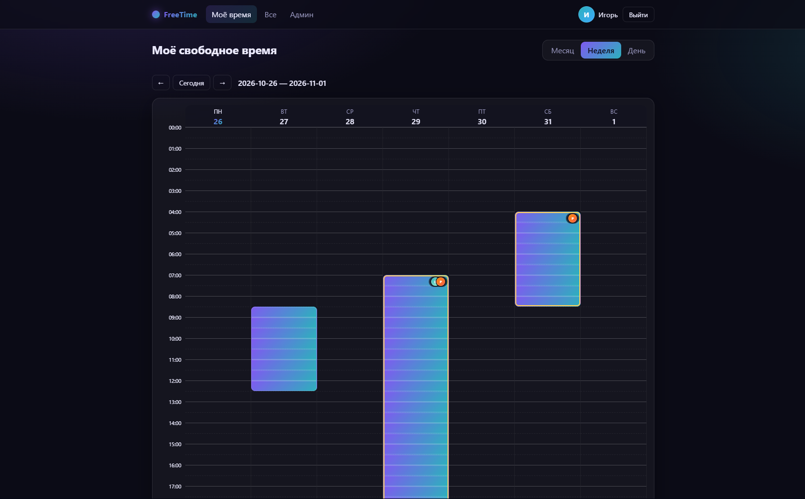
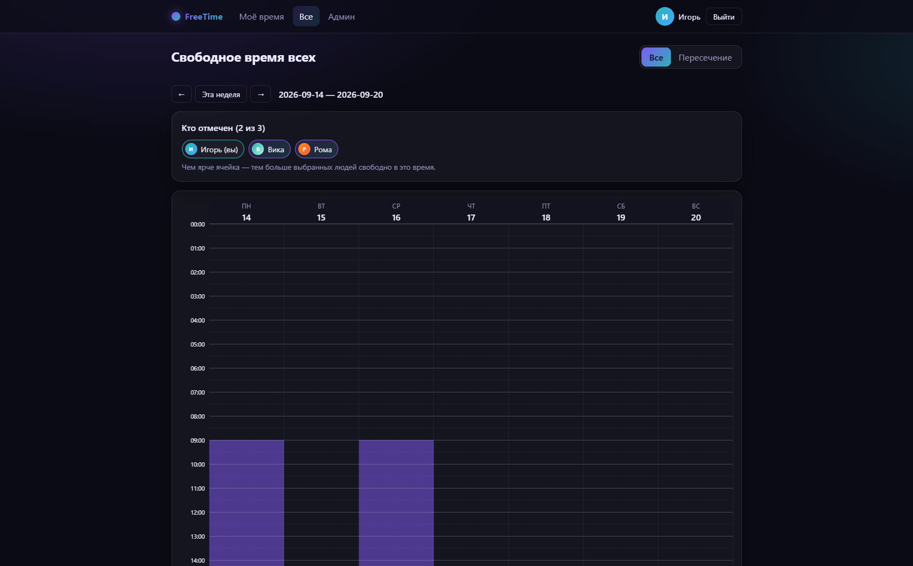
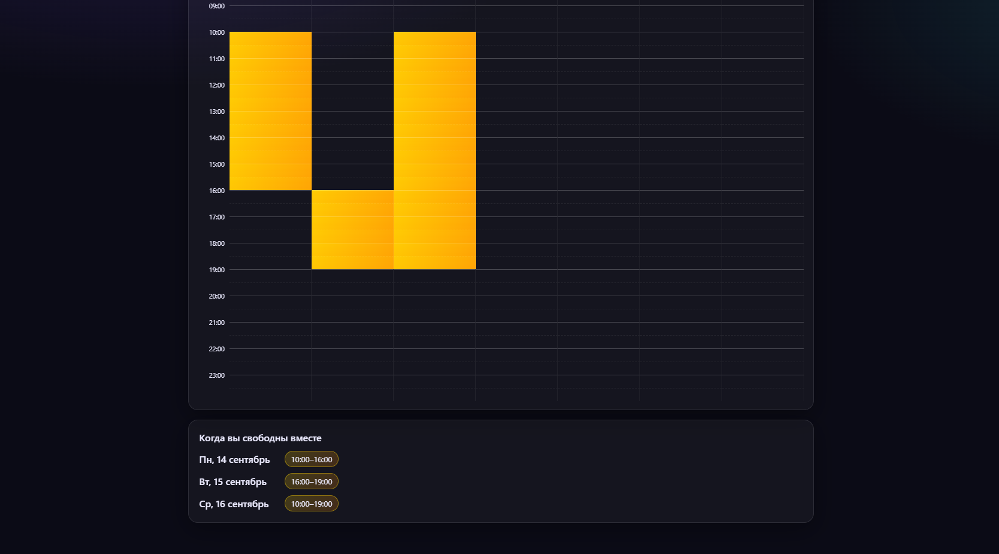

# Free Time Finder

Небольшое веб-приложение, чтобы находить общее свободное время с друзьями.
Каждый отмечает на календаре, когда он свободен; страница «Все» показывает
чужие отметки и **пересечения** — когда вы свободны одновременно.

- **Личный кабинет**: календарь (месяц / неделя / день), сетка получасовых
  слотов + точные интервалы, профиль (ник, аватар).
- **Авторизация без регистрации**: аккаунты создаёт админ и выдаёт временные
  пароли; пользователь меняет пароль при первом входе.
- **Админ-панель** (только роль `admin`): создание / редактирование / удаление
  пользователей, сброс паролей и правка чужих отметок свободного времени.

## Скриншоты

**Моё время** — свой календарь (неделя): отмеченные блоки свободного времени,
иконки показывают, кому виден интервал.



**Все** — свободное время выбранных людей на одной сетке: чем ярче ячейка, тем
больше людей свободно.



**Пересечение** — когда свободны все выбранные одновременно, со списком
общих интервалов по дням.



## Стек

- **client/** — React + Vite (фронтенд)
- **server/** — Express + SQLite (`better-sqlite3`), JWT-авторизация, bcrypt

## Структура

```
free-time-finder/
├── client/                 # React-приложение (Vite)
│   └── src/
│       ├── api.js           # обёртка над fetch + хранение токена
│       ├── auth/            # контекст авторизации
│       ├── components/      # переиспользуемые компоненты (сетка, аватар, layout)
│       ├── lib/             # утилиты времени и интервалов (вся логика пересечений)
│       ├── pages/           # экраны (вход, календарь, профиль, все, админка)
│       └── styles/          # глобальные стили (градиенты, адаптив)
└── server/                 # Express API
    └── src/
        ├── config.js        # настройки из .env
        ├── db/              # подключение к SQLite, schema.sql, сидинг админа
        ├── middleware/      # auth, проверка роли, загрузка файлов
        ├── models/          # доступ к данным (users, availability)
        ├── controllers/     # обработчики запросов
        ├── routes/          # маршруты API
        └── utils/           # пароли, токены, валидация, интервалы
```

## Запуск (разработка)

Нужен Node.js 18+ (проверено на 24).

```bash
# 1. Установить зависимости (корень + client + server)
npm run install:all

# 2. Создать конфиг сервера
cp server/.env.example server/.env
#    затем впишите свой JWT_SECRET (см. подсказку в файле)

# 3. Запустить фронтенд и бэкенд вместе
npm run dev
```

- Фронтенд: <http://localhost:5173> (проксирует `/api` на сервер)
- API: <http://localhost:4000>

При первом старте создаётся админ из `server/.env`
(по умолчанию логин `admin`, пароль `admin`). Войдите и сразу смените пароль.

## Запуск (продакшен, например на Raspberry Pi)

Первичная установка:

```bash
npm run install:all
cp server/.env.example server/.env   # задайте PORT и надёжный JWT_SECRET
npm run build                        # собирает client/dist
npm start                            # сервер отдаёт и API, и собранный фронтенд
```

Сервер слушает один порт (`PORT`) и отдаёт и API, и собранный фронтенд.

### Автозапуск + HTTPS (как настроено на Pi)

Приложение запускается как systemd-сервис `freetimefinder` (автостарт при
загрузке, перезапуск при сбое). Перед ним стоит **Caddy** как reverse-proxy:
держит HTTPS (бесплатный сертификат Let's Encrypt для домена DuckDNS,
обновляется сам) и проксирует на приложение (`localhost:PORT`). На роутере
проброшены порты **80 и 443** на Pi (к Caddy, не к приложению).

### Повторный деплой

После изменений в коде — пересобрать клиент и перезапустить сервис одной
командой:

```bash
npm run deploy      # scripts/deploy.sh: install → build → restart → health-check
```

## Данные

- База: `server/data/app.db` (SQLite, создаётся автоматически).
- Аватары: `server/uploads/`.

Оба пути в `.gitignore`. Для бэкапа достаточно скопировать эти папки.

## Как добавить функционал

- Новое поле/таблица — в `server/src/db/schema.sql` и соответствующую модель.
- Новый API — контроллер в `controllers/`, маршрут в `routes/`.
- Новый экран — компонент в `client/src/pages/` и маршрут в `client/src/App.jsx`.
